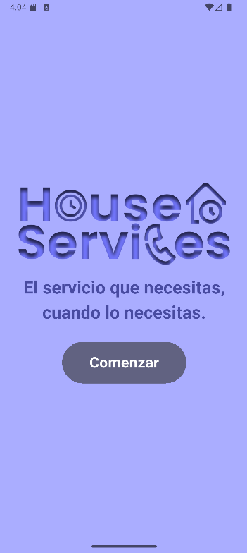
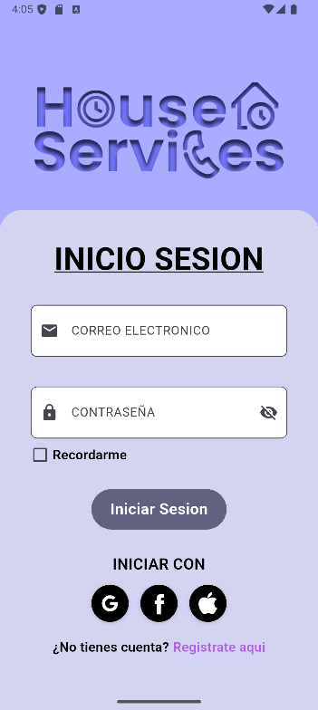
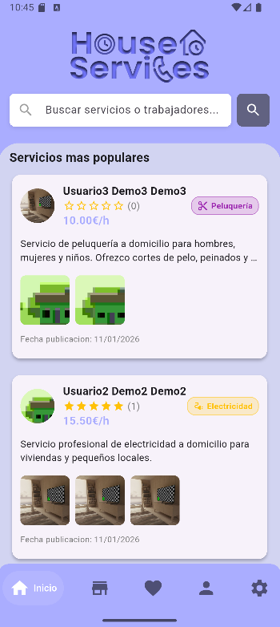
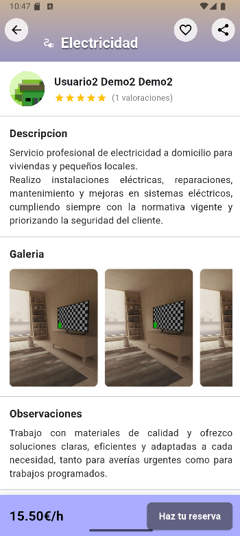
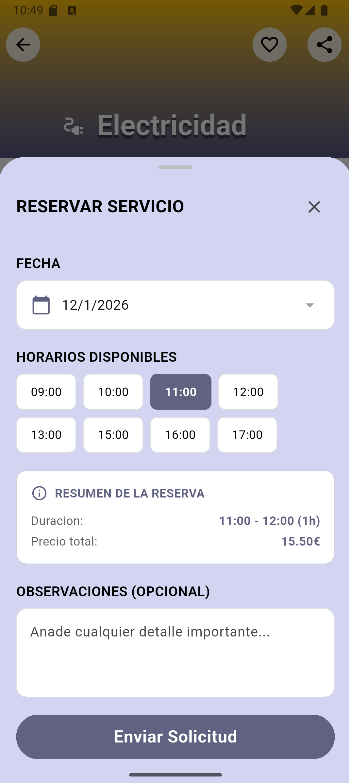
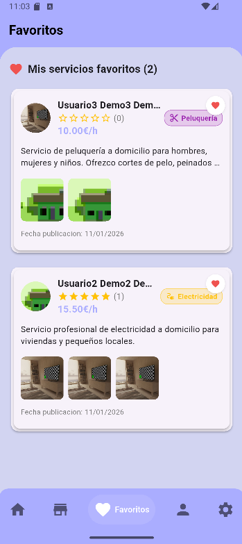
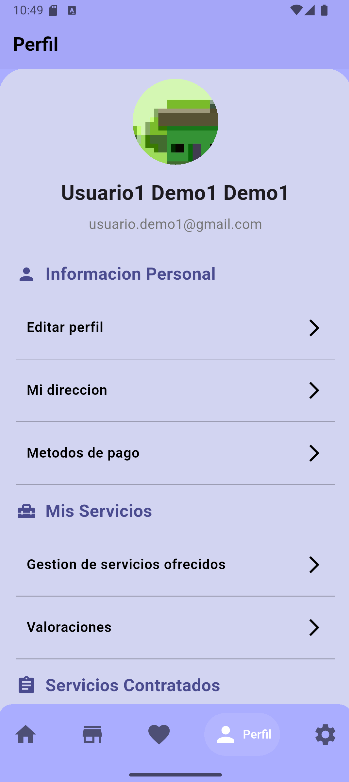
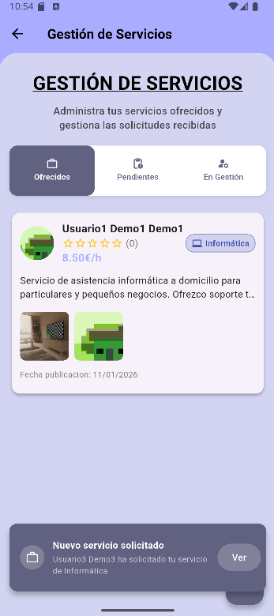
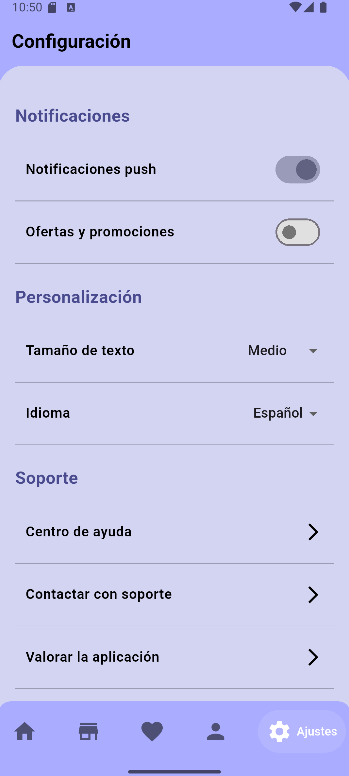

# HouseServices

**English** · [Español](README.es.md)

Mobile app for **booking and offering home services**, with a backend that implements its **own REST API** and a simple setup to run the local infrastructure with **Docker**.

## Technologies

- **App (frontend):** Flutter (Dart)
- **API (backend):** Kotlin + Spring Boot
- **Database:** MySQL
- **Local infrastructure:** Docker + Docker Compose (starts MySQL + backend)
- **Firebase Auth:** sign-up and sign-in
- **Firebase Storage:** image upload and management
- **Firebase Cloud Messaging (FCM):** push notifications
- **Cloud Firestore:** favorites (services saved by the user)
- **Google Maps API:** map and location picking/display
- **Version control:** Git + GitHub
- **UI/UX prototyping:** Figma

## Prototype (Figma)

Interactive prototype:
https://www.figma.com/proto/B4juOMcrYVCbK1gicMqVDt/HouseService?node-id=0-1&t=xdG3FS1GkZtTF3uk-1

## Features

### For customers

- Sign-up and sign-in with a full profile (personal details, location and optional photo).
- Services listed by category, search by name/description and a featured section.
- Service details with images, hourly price, description, notes and the worker's average rating.
- Booking by choosing an available day and time and adding notes.
- Cancelling requests according to the rules defined in the booking flow.
- Favorites to save or remove services and access them quickly.
- Service history and reviews with a star rating and a comment once the service is finished.

### For workers

- Publishing services with category, price, description, images and notes.
- Availability management with daily schedules and exceptions (unavailable days or special time slots).
- Managing incoming requests, with the option to accept or decline them and notify the customer.
- Managing confirmed services: marking start and finish, and tracking them by status.

### Notifications

- Push notifications (FCM) for relevant events (new request, accepted/declined, status changes), plus in-app alerts with custom notifications.

## Roles (customer and worker)

- The same user can act as a **customer** or as a **worker**.
- From the **offered services** section, the app shows a dialog to **activate the worker role** (designed as the basis for real verification in a production environment before allowing users to publish services).

## Installation and startup

The full guide is in `docs/SETUP.md` (in Spanish) and covers:
- Starting **MySQL + backend** with Docker Compose.
- The files needed for Firebase (client and Admin SDK) and Google Maps.
- Running the app with the backend URL passed through `--dart-define`.

## Credentials and configuration (not included in the repo)

For security reasons, this repository does **NOT include real credentials** (Firebase Admin SDK, `application.properties`, Google Maps keys, etc.).
To find out which files or keys are needed for everything to work, see `docs/SETUP.md`.

## Repository structure
- `frontend/` -> Flutter app (Dart)
  - `lib/` -> UI, controllers, models, services, utils
  - `android/`, `ios/`, `web/` -> platforms
- `backend/` -> Kotlin/Spring Boot REST API
  - `controllers/` -> HTTP endpoints
  - `services/` -> business logic
  - `repositories/` -> data access (MySQL)
  - `models/` + `dto/` -> entities and data transfer objects
- `infra/` -> Docker Compose + MySQL initialization scripts
  - `db/init/` -> startup SQL
- `docs/` -> documentation (SETUP, etc.)
- `resources/` -> resources for the documentation/README (logos and images)

## Authorship and resources
- The project's **design**, **logo** and main graphic resources were created by **Rafael Antonio Muñoz Fernández**.
- Note: some third-party icons/logos/images (e.g. Google/Apple/Facebook brands) belong to their respective owners.

## Security
If you find a security issue, see `SECURITY.md`.

## License
MIT — see the `LICENSE` file.

## App screenshots

  
  
  

  
  
  

  
  
  

